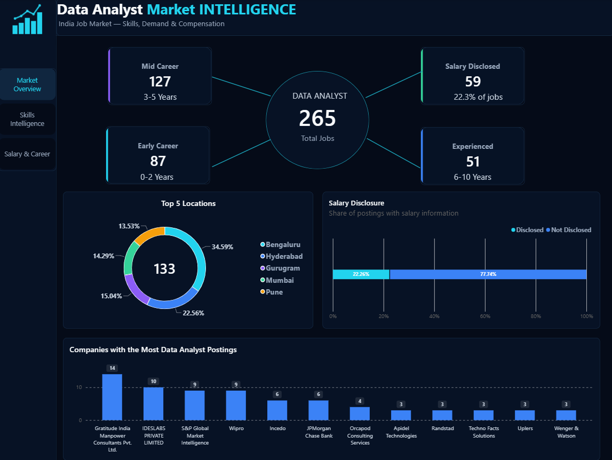
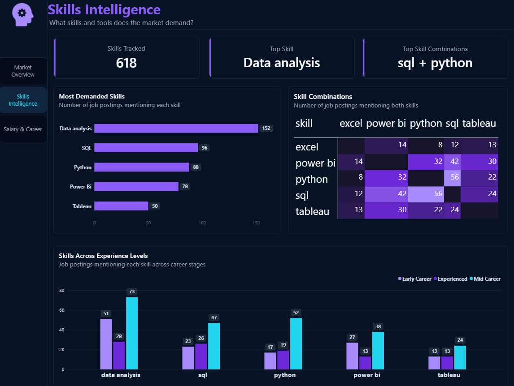
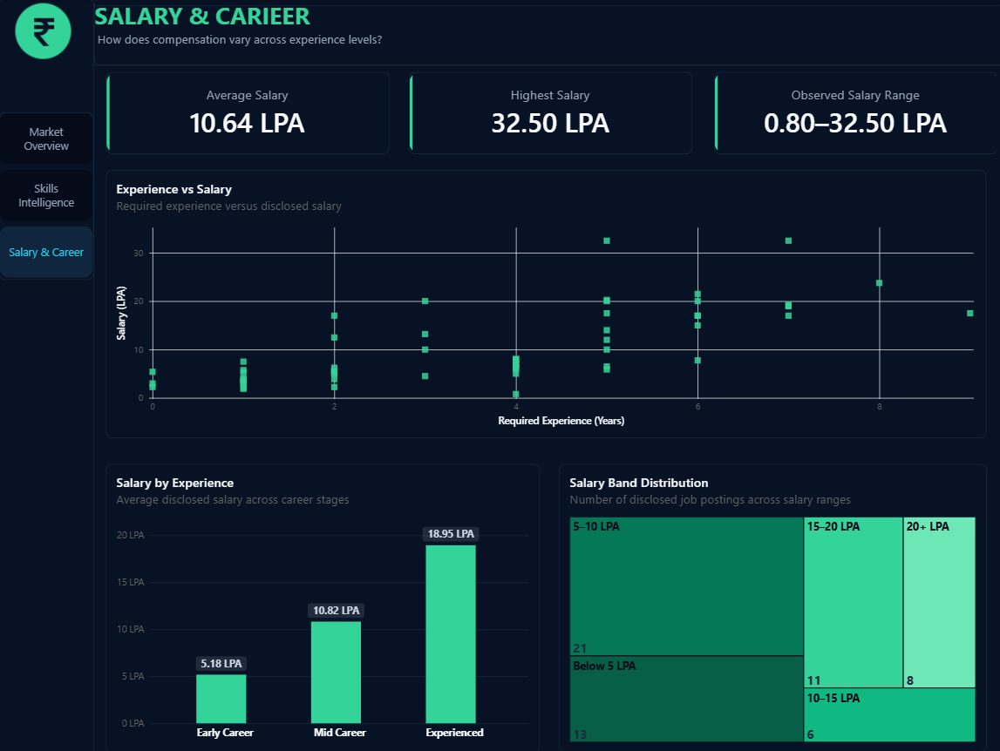

# Data Analyst Market Intelligence

An end-to-end data analytics project exploring the Indian Data Analyst job market through job postings, required skills, experience levels, salary information, locations, and companies.

The project covers the complete analytics workflow — from data cleaning and preparation in Python to SQL analysis and interactive visualization in Power BI.

---

## Project Overview

The goal of this project is to analyze the Data Analyst job market and identify patterns in:

- Job demand across locations
- Companies with the highest number of Data Analyst postings
- Most frequently demanded skills
- Common skill combinations
- Skill requirements across experience levels
- Salary distribution and disclosed salary ranges
- Salary variation across career stages
- Relationship between required experience and disclosed salary

The analysis is presented through a three-page Power BI dashboard.

---

## Dashboard

### 1. Market Overview

Provides a high-level view of the Data Analyst job market, including:

- Total job postings
- Experience-level distribution
- Salary disclosure
- Top job locations
- Companies with the highest number of postings



---

### 2. Skills Intelligence

Explores the skills requested across Data Analyst job postings, including:

- Most demanded skills
- Skill combinations
- Skills across experience levels
- Demand for SQL, Python, Power BI, Tableau, and Excel



---

### 3. Salary & Career

Analyzes disclosed salary information across career stages, including:

- Average salary
- Highest observed salary
- Observed salary range
- Salary distribution by band
- Salary by experience level
- Experience versus disclosed salary



---

## Key Findings

Based on the analyzed Data Analyst job postings:

- The dataset contains **265 Data Analyst job postings** used in the final analysis.
- **Bengaluru** has the highest number of postings among the analyzed locations.
- **59 postings** contain disclosed salary information.
- **Data Analysis** is the most frequently tracked skill, appearing in **152 postings**.
- **Data Analysis + Python** is the most common skill combination, appearing in **65 postings**.
- Average disclosed salary is approximately **10.64 LPA**.
- Observed disclosed salaries range from **0.80 LPA to 32.50 LPA**.
- Average disclosed salary varies across Early Career, Mid Career, and Experienced groups in the analyzed data.

> Salary findings are based only on postings with disclosed salary information and should not be interpreted as a complete representation of the overall Data Analyst job market.

---

## Tools & Technologies

- **Python** — Data cleaning and preparation
- **Pandas** — Data manipulation
- **MySQL** — Data transformation and analysis
- **SQL** — Market and skills analysis
- **Power BI** — Interactive dashboard development
- **DAX** — Measures and calculated fields
- **Excel** — Source data handling

---

## Project Workflow

```text
Kaggle Dataset
      ↓
Python Data Cleaning & Preparation
      ↓
MySQL Data Transformation
      ↓
SQL Analysis
      ↓
Power BI Data Modeling & Visualization
      ↓
Interactive Dashboard